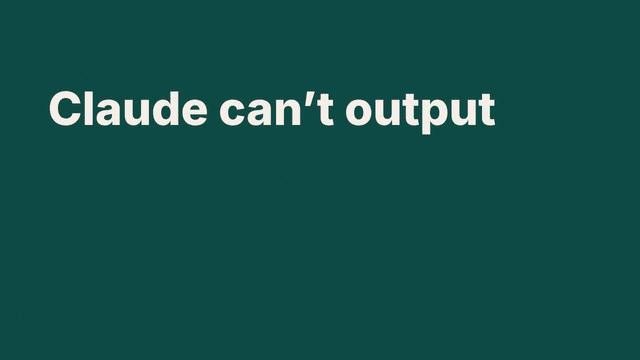

# code-video

A Claude Code skill for making videos the way the viral "Opus 5.5 videos" are made: Claude writes a program that draws every frame, headless Chromium captures each one, and ffmpeg encodes the MP4.



[`docs/demo.mp4`](docs/demo.mp4): the 15 s example in `skills/code-video/examples/pipeline-explainer/`, with its synthesized soundtrack.

No video framework, no license terms, and nothing to install beyond Node, Playwright and ffmpeg.
If you want Remotion or HyperFrames, use their official skills instead; this one is for the plain pipeline they both wrap.

## What it gives Claude

- **A contract.** One HTML file defines `window.VIDEO` and `window.drawFrame(f)`, and each frame depends only on `f`. No clocks, timers, CSS animations or unseeded randomness, so every render is identical and any frame can be redrawn alone.
- **A work loop.** Brief, `SPEC.md` with numbers instead of adjectives, build, gate, contact sheet, ranked notes, fixes, sound, render, verify, delivery note.
- **Scripts.**

| Script | Does |
|---|---|
| `render.mjs` | Renders every frame and pipes it to ffmpeg (H.264 yuv420p, optional AAC audio), or exports the scene's cue times |
| `check.mjs` | Gates: page errors, clock or random reads inside `drawFrame`, blank frames, determinism (frames drawn forward vs in reverse in a fresh page) |
| `sheet.mjs` | A contact sheet of the scene with each tile's time stamped: one frame per second plus every cut at -0.2 / 0 / +0.2 s. Claude reads it as an image to review a cut before rendering. |
| `soundtrack.py` | A numpy-synthesized bed with a whoosh on each cut, ticks, pops and an impact, timed from the scene's cues |

- **References.** Craft floors (type size, read times, pacing, safe zones), a `SPEC.md` template, a list of the defaults generated video falls into, and sound and loudness rules.
- **A template scene and a finished example.**

## Install

Requirements: Node 18+, ffmpeg, Playwright with Chromium (`npm i playwright && npx playwright install chromium`), and Python 3 with numpy for the soundtrack.

As a Claude Code plugin:

```sh
claude plugin marketplace add Tengs-Fan/Video-Making
claude plugin install code-video@code-video
```

With the skills CLI:

```sh
npx skills add Tengs-Fan/Video-Making
```

Or copy `skills/code-video/` into `~/.claude/skills/` (all projects) or `.claude/skills/` (one project).

## Use

Ask for a video:

> Make a 20-second launch video for this repo, 1920x1080, with sound. Read the README and the site in `docs/` for the real copy and colours.

Claude writes `SPEC.md`, builds `scene.html` from the template, runs the gates and a contact sheet, fixes what it finds, and renders `out.mp4`.

To run the pipeline by hand on the example:

```sh
S=skills/code-video
node $S/scripts/check.mjs $S/examples/pipeline-explainer/scene.html
node $S/scripts/sheet.mjs $S/examples/pipeline-explainer/scene.html sheet.png
node $S/scripts/render.mjs $S/examples/pipeline-explainer/scene.html --cues cues.json
python3 $S/scripts/soundtrack.py cues.json track.wav
ffmpeg -y -i track.wav -af loudnorm=I=-16:TP=-1.5:LRA=11 -ar 44100 track-norm.wav
node $S/scripts/render.mjs $S/examples/pipeline-explainer/scene.html out.mp4 --audio track-norm.wav
```

On a 4-CPU cloud container the example (1280×720, 450 frames) renders in about 32 s, and two renders produce byte-identical MP4s.

## Limits

Code draws type, diagrams, UI, charts and stylised 3D well, and faces, animals and photoreal footage badly; bring real assets for those.
Claude cannot hear: the sound is planned from cues and measured for loudness, not listened to.

## Credits

The review loop, craft floors and banned-defaults list condense ideas from [HyperFrames](https://github.com/heygen-com/hyperframes)' skill (Apache-2.0, HeyGen) and [Remotion's agent skills](https://github.com/remotion-dev/skills), and from workflows shared by creators in [awesome-opus5-5-videos](https://github.com/yihui-dev/awesome-opus5-5-videos).
No code is copied from them.

MIT license.
